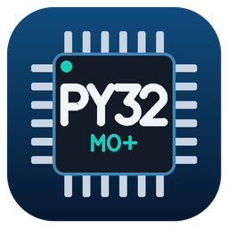
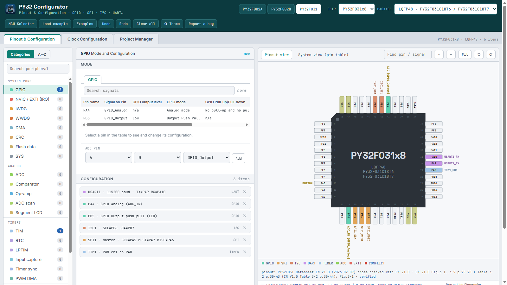
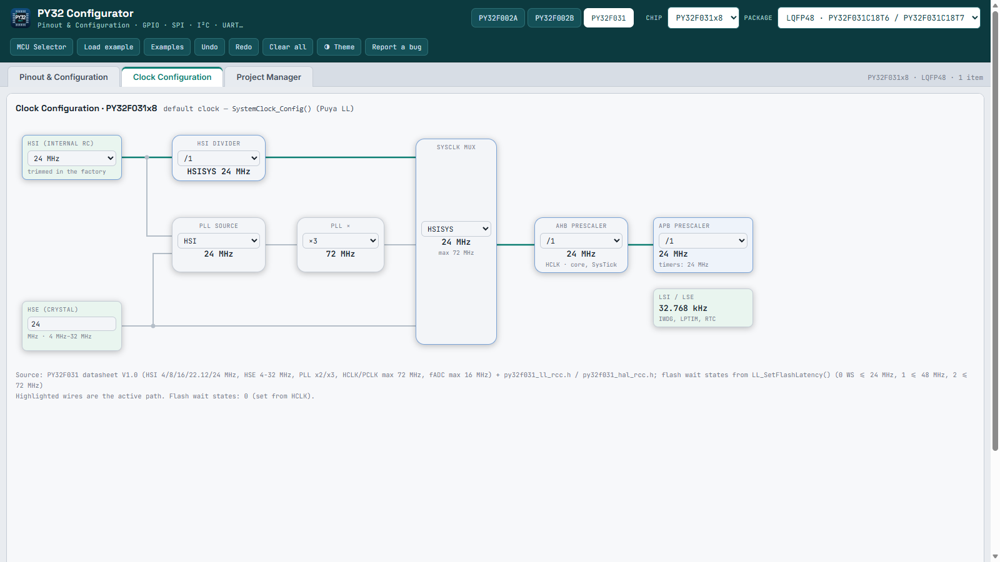
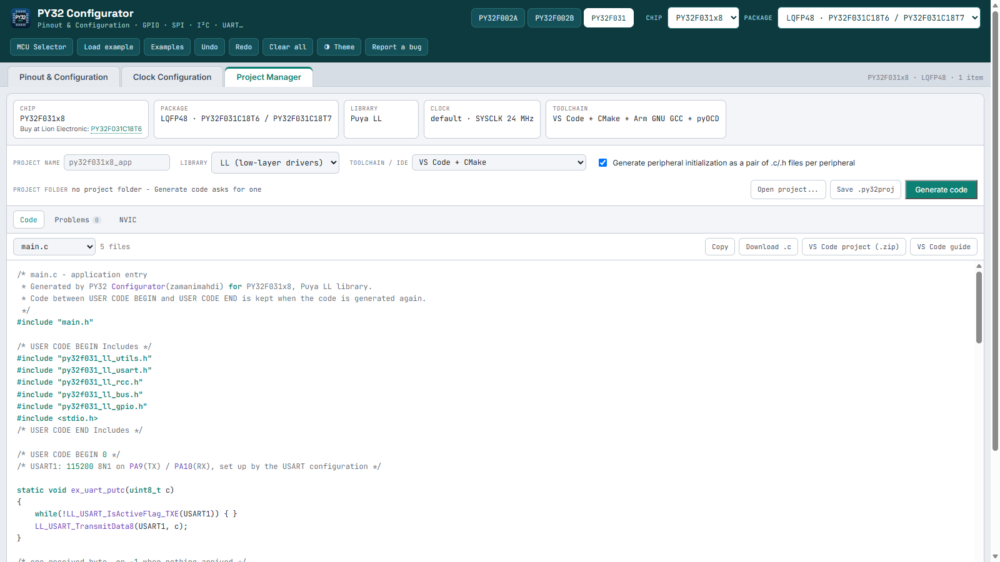
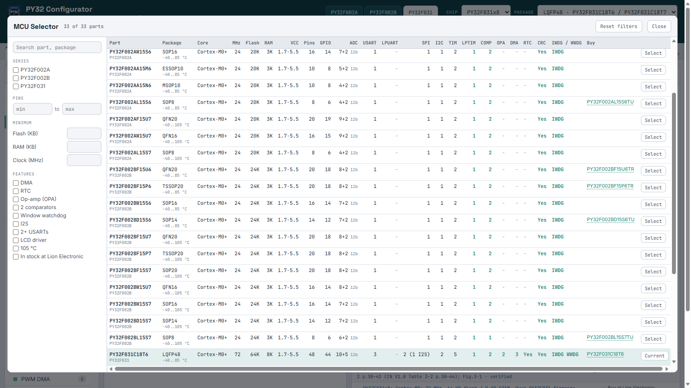
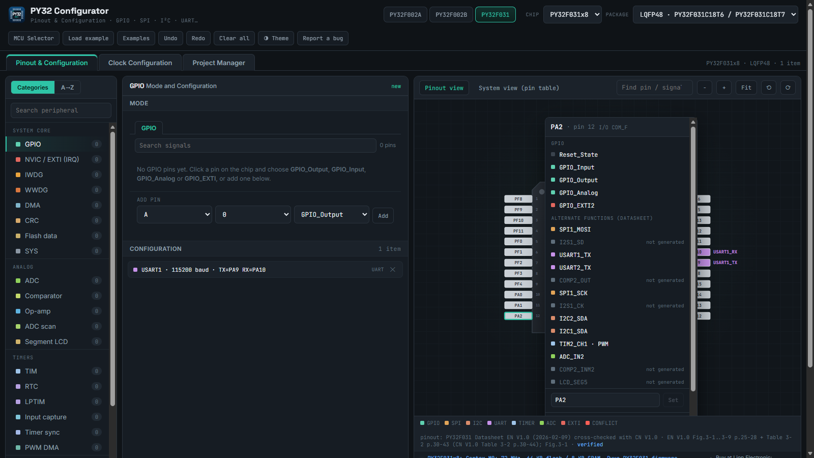

<p align="center"></p>

<h1 align="center">PY32 Configurator</h1>

<p align="center">
A CubeMX-style pin, clock and peripheral configurator for <b>Puya PY32</b> Cortex-M0+ microcontrollers<br>
PY32F002A · PY32F002B · PY32F031 — Puya <b>LL</b> or <b>HAL</b> library — VS Code + CMake or PlatformIO projects
</p>

<p align="center">
<a href="https://github.com/zamanimahdi/PY32-Configurator-App/releases/latest"><b>Download</b></a> ·
<a href="https://github.com/zamanimahdi/PY32-Configurator-App/issues/new?template=bug_report.yml"><b>Report a bug</b></a> ·
<a href="#english">English</a> ·
<a href="#فارسی">فارسی</a>
</p>

<p align="center"></p>

---

<a id="english"></a>

## English

### Contents

- [What it does](#what-it-does)
- [Download](#download)
- [Install and first run](#install-and-first-run)
- [Your first project](#your-first-project)
- [Screenshots](#screenshots)
- [Features](#features)
- [Desktop app](#desktop-app)
- [Command line and MCP server (py32cfg)](#command-line-and-mcp-server-py32cfg)
- [Reporting bugs](#reporting-bugs)
- [Limitations](#limitations)
- [License](#license)

### What it does

Pick a chip and package, click the pins, set the clock tree and the peripherals, and PY32 Configurator writes the C init code for the official Puya firmware library. **Generate code** creates a complete project for **VS Code + CMake** or **PlatformIO** that builds, flashes and debugs out of the box, and keeps your own code (USER CODE sections) when you change the configuration later. Everything runs locally; nothing is uploaded.

- 3 series, 23 packages, 33 ordering codes, with datasheet-checked pinouts and alternate functions.
- Up to 23 peripheral modules per chip (GPIO, EXTI/NVIC, USART, SPI, I2C, ADC + scan + DMA, timers, PWM, input capture, LPTIM, comparators, op-amps, RTC, watchdogs, DMA, low power, flash data, segment LCD, ...).
- 15 ready-to-build examples, an MCU Selector, pin and electrical checks, and a Problems list.
- A command line tool and an MCP server so scripts and AI tools can drive it.

### Download

Get the files from **[Releases → latest](https://github.com/zamanimahdi/PY32-Configurator-App/releases/latest)**.

| System | File | Notes |
|---|---|---|
| Windows 10/11 (x64) | `PY32-Configurator.exe` | One file, no installer. Uses Microsoft Edge WebView2 (built into Windows 11 and updated Windows 10). |
| Linux x86_64 | `PY32-Configurator-linux-x86_64.tar.gz` | One file, Qt WebEngine inside, runs on most distributions. |
| macOS 12+ (Apple silicon) | `PY32-Configurator-macos-arm64.zip` | Unzip and move to Applications. |
| Command line + MCP (Windows) | `py32cfg.exe` | One file, Node.js inside. |
| Checksums | `SHA256SUMS.txt` | SHA-256 of every file. |

### Install and first run

- **Windows:** run `PY32-Configurator.exe`. The file is not code-signed, so SmartScreen may show *Windows protected your PC*: click **More info → Run anyway**.
- **Linux:** `tar xzf PY32-Configurator-linux-x86_64.tar.gz`, then `./PY32-Configurator`. Qt needs a few system libraries; on Ubuntu/Debian: `sudo apt install libxcb-cursor0 libxkbcommon-x11-0 libegl1 libnss3`.
- **macOS:** the app is not notarized. The first time, right-click it → **Open** → **Open**.
- Settings and recent projects are stored per user. Nothing is sent anywhere.

To build and flash the generated projects you also need, once:

1. **VS Code** with the *CMake Tools* and *Cortex-Debug* extensions (the exported project recommends them).
2. Run the task **PY32: Setup** in the exported project. It installs or finds the Arm GNU toolchain, CMake, Ninja and pyOCD, and downloads exactly the Puya library files the project needs (each one checked by SHA-256).
3. A debug probe: CMSIS-DAP (DAPLink), ST-Link or J-Link on SWDIO/SWCLK, GND and VCC.

### Your first project

1. Choose the series (**PY32F002A / PY32F002B / PY32F031**), the chip and the package at the top.
2. Click a pin and choose a function, for example `GPIO_Output`, and give it a label such as `LED`.
3. Add peripherals from **Categories** on the left (for example **UART / USART**), and check **Clock Configuration**.
4. Open **Project Manager**: set the project name, **Library** (LL or HAL) and **Toolchain / IDE**.
5. Press **Generate code** and choose an empty folder. Open the folder in VS Code.
6. Run **PY32: Setup** once, then **PY32: Build** (Ctrl+Shift+B) and **PY32: Flash**, or press F5 to debug.
7. Write your code between `/* USER CODE BEGIN */` and `/* USER CODE END */`. Change the configuration later and press **Generate code** again: your code is kept, and changed files are backed up in `.py32-backup/`.

Or start from **Examples**: choose one, press Generate code, build and flash.

### Screenshots

| | |
|---|---|
|  |  |
| **Clock Configuration** | **Project Manager and code** |
|  |  |
| **MCU Selector** | **Pin menu (dark theme)** |

### Features

#### Supported chips

| Series | Parts | Packages | Core / clock | Flash / RAM | Library |
|---|---|---|---|---|---|
| PY32F002A | PY32F002Ax5 | QFN20, TSSOP20, QFN16, SOP16, ESSOP10, MSOP10, SOP8 | Cortex-M0+, 24 MHz | 20 KB / 3 KB | `PY32F0xx_Firmware` |
| PY32F002B | PY32F002Bx5 | QFN20, TSSOP20, SOP20, QFN16, SOP16, SOP14, SOP8 | Cortex-M0+, 24 MHz | 24 KB / 3 KB | `PY32F002B_Firmware` |
| PY32F031 | PY32F031x4 / x6 / x7 / x8 | LQFP48, QFN48 (6x6, 5x5), QFN40, LQFP32, QFN32 (5x5, 4x4), TSSOP20, DFN8 | Cortex-M0+, 72 MHz | 16 / 32 / 48 / 64 KB, 2 / 4 / 6 / 8 KB | `PY32F031_Firmware` |

The libraries are the official Puya firmware packages (HAL + LL, CMSIS, GCC startup and linker files), from <https://github.com/OpenPuya>. Not every peripheral exists on every chip; a peripheral appears in Categories only on chips that have it. See [Limitations](#limitations).

#### Layout

The page follows the STM32CubeMX layout:

- Three main tabs: **Pinout & Configuration**, **Clock Configuration** and **Project Manager**.
- The Pinout page has three columns: **Categories** (grouped or A→Z, with search) | **Mode and Configuration** | **Pinout view / System view**.
- **Light theme** (default) and **dark theme**. Switch with the Theme button; the choice is remembered.

#### Pinout & Configuration

- **Chip view**: the part is drawn as its real package (QFN / LQFP / TSSOP / SOP / ESSOP / MSOP / DFN) with pin numbers, names, the pin 1 marker and the exposed pad. Choose the package from the *Package* list.
- **Zoom and pan**: mouse wheel or +/−, drag to pan, *Fit* to reset.
- **Rotation**: rotate the chip in 90° steps with the rotate buttons or `R` / `Shift+R`.
- **Pin menu**: click a pin to get `Reset_State`, `GPIO_Input`, `GPIO_Output`, `GPIO_Analog`, `GPIO_EXTIx` and the alternate functions of the datasheet AF table (ADC, SPI, I²C, USART, timer channels, comparator outputs, and so on). The AF number comes from the datasheet table and goes into the code. Functions that are not generated are shown greyed out.
- **User label**: a label `LED` becomes `#define LED_Pin` / `LED_GPIO_Port`.
- **Checks**: two functions on one pin, a function the datasheet does not list for that pin, or a pin that is not bonded out on the chosen package is shown in red on the chip and in **Problems**. A **Fix** button moves a function to a free pin that has it.
- **System view**: a table of every pin with its signal, label and datasheet functions.

Pinouts and AF tables were transcribed from the Puya datasheets (PY32F002A V1.1 CN cross-checked with V0.2 EN, PY32F002B V1.8 EN/CN, PY32F031 V1.0 EN/CN) for every package.

#### GPIO panel

Like the CubeMX GPIO panel: a table of every GPIO/EXTI pin (**Pin Name, Signal, Output level, Mode, Pull, Speed, User Label**). Click a row to edit that pin below the table; an **Add pin** row adds a GPIO without the chip view.

#### Clock Configuration

A clock tree like CubeMX. Click a block to set it.

- **PY32F002A**: HSI (8 or 24 MHz trim), HSE (crystal or external clock, up to 24 MHz), LSI, system clock mux, AHB and APB prescalers.
- **PY32F002B**: HSI with HSIDIV, external clock input (no crystal), LSI, LSE, system clock mux, AHB / APB prescalers.
- **PY32F031**: HSI (4 / 8 / 16 / 22.12 / 24 MHz) with HSIDIV, HSE, LSI, LSE, **PLL ×2 / ×3** up to 72 MHz, system clock mux, AHB / APB prescalers, flash latency from the HCLK.
- **Limits** (maximum SYSCLK, HSE range, flash wait states) are checked and reported in **Problems**.
- **Code**: `SystemClock_Config()` is generated for the chosen library. The real bus clocks feed the UART baud rate, timer and ADC settings.

#### Peripherals

| Category | Peripheral | Chips / notes |
|---|---|---|
| System Core | GPIO, EXTI | all |
| System Core | IWDG | all |
| System Core | WWDG | PY32F031 |
| System Core | DMA | PY32F031 |
| System Core | SYS (debug pins) | all |
| System Core | CRC, data in flash | all |
| Analog | ADC (single channel, scan + analog watchdog) | all |
| Analog | COMP (comparators) | all |
| Analog | OPA | PY32F031 |
| Timers | TIM: time base + update IRQ, PWM, encoder | all (TIM1, TIM14/TIM16, TIM2/TIM17 on F031) |
| Timers | Input capture / PWM input, master/slave sync, PWM from DMA (WS2812) | where the timers / DMA exist |
| Timers | LPTIM | all |
| Timers | RTC | PY32F031 |
| Connectivity | USART, SPI, I²C | all (USART1–3, SPI1–2, I2C1–2 on F031) |
| Power | Low-power modes (sleep / stop) | all |
| Display | Segment LCD | PY32F031 |

Invalid settings are reported in **Problems**: pin conflicts, missing pins, clock limits, values out of range, and so on.

#### LL or HAL

**Project Manager > Library** selects the Puya **LL** (default) or **HAL** library. Every generator writes code for both:

- LL: `LL_GPIO_Init`, `LL_USART_Init`, `LL_TIM_Init`, ... with `USE_FULL_LL_DRIVER`.
- HAL: handles (`huart1`, `htim1`, `hadc1`, ...) and `HAL_xxx_Init` calls. The pin and clock setup is inside each peripheral's init function (no MSP file). The interrupt handlers call the HAL IRQ handlers, and `<prefix>_hal_conf.h` is generated.

The library choice is saved in the project file.

#### Project Manager and code output

- Cards for chip, package, library, clock and project.
- The generated code with a file selector (`main.c`, `gpio.c`, `usart.c`, `<prefix>_it.c`, ...), **Copy code** and **Download .c**.
- **Problems** list (errors and warnings).
- **NVIC table**: every enabled interrupt with its priority (0–3).
- Project settings: **project name**, **Library** (LL / HAL), **Toolchain / IDE** (VS Code + CMake or PlatformIO), **one .c/.h pair per peripheral**, project folder, **Open project**, **Save .py32proj**, **Generate code**.
- **Undo / Redo** (Ctrl+Z / Ctrl+Y).

#### Projects: open, change, generate again

Like an STM32CubeMX `.ioc` project:

- **The project file** `<name>.py32proj` holds the whole configuration (chip, package, library, pins and labels, peripherals, clock tree, NVIC). It is saved in the project folder.
- **Generate code** writes the project into that folder. The first time it asks for a folder; after that it updates the same folder.
- **Your code is kept**: generated files have `USER CODE BEGIN x` / `USER CODE END x` sections (includes, before `main`, start of `main`, after the init calls, the main loop, interrupt handlers, each peripheral file, and one in `CMakeLists.txt`). Code inside them is carried into the new files. Files you added yourself are not touched.
- **Safety**: every file that changes is first copied to `.py32-backup/<date-time>/`.
- **One .c/.h pair per peripheral** (on by default): `main.c` calls `MX_GPIO_Init()`, `MX_USART_Init()`, `MX_ADC_Init()`, ... from `gpio.c/h`, `usart.c/h`, `adc.c/h`. Turn it off to get everything in `main.c`.

#### VS Code project export

The project contains:

- `src/` (main, one `.c/.h` pair per peripheral, `<prefix>_it.c`, HAL config), `<name>.py32proj` and `py32-project.json`.
- `CMakeLists.txt` that builds against the Puya firmware library (drivers, startup file, linker script with the chip's memory sizes) and outputs `.elf`, `.hex` and `.bin`. Library sources are compiled with warnings off; your code with `-Wall`.
- `.vscode/` with recommended extensions, tasks, a Cortex-Debug launch config (pyOCD) and IntelliSense settings.
- `tools/py32.ps1` (Windows) and `tools/py32.sh` (Linux/macOS), behind the VS Code tasks:
  - **PY32: Setup** installs or finds the prerequisites and downloads the Puya firmware library for the chip into `sdk/` (or set `py32.sdkDir` to an existing copy).
  - **PY32: Doctor** checks every tool and says what is missing.
  - **PY32: Build** (`Ctrl+Shift+B`), **PY32: Flash (pyOCD)**, **PY32: Clean**.
- `README.md` with a step-by-step guide.

Steps: unzip or Generate → open the folder in VS Code → install the recommended extensions → run **PY32: Setup** → `Ctrl+Shift+B` → `F5` to debug.

#### PlatformIO export

**Toolchain / IDE = PlatformIO** writes a `platformio.ini`. PlatformIO has no Puya framework, so the project uses the generic Arm build of the `ststm32` platform (no framework) plus a build script that adds the Puya firmware library (downloaded with checksums, or from `custom_py32_sdk_dir`) and sets up `pio run -t upload` with pyOCD and the Puya device pack.

#### Examples

The **Examples** button lists ready-to-build sample applications for the selected chip. Loading one sets the pins, peripherals and clock and puts the application code into the USER CODE sections, so Generate code gives a project that builds at once.

| Example | Notes |
|---|---|
| Blink, Button interrupt toggles LED, UART echo + printf, ADC read printed over UART, PWM breathing LED, 1 kHz timer interrupt | every chip |
| I2C bus scan, SPI loopback test, Independent watchdog, Stop mode wake on button, Comparator threshold, LPTIM wake-up from stop | chips that have the peripheral |
| ADC + DMA averaging, WS2812 RGB LED strip | PY32F031 (DMA) |
| Flash data save / restore | all |

#### MCU Selector

The **MCU Selector** button opens a table of every chip and ordering code, like the CubeMX MCU Finder: pins, GPIO, ADC channels, clock, flash/RAM, supply voltage and the peripherals, with search and filters. Click a row to open that chip and package. Parts sold by Lion Electronic (lionelectronic.ir) have a link to the shop page.

#### Pin checks

- **Debug pins:** a GPIO or peripheral on SWDIO/SWCLK (PA13/PA14 on PY32F002A and PY32F031, PB6/PA2 on PY32F002B; PC0 can also be SWDIO there) gives a warning, because the pin belongs to the debugger after reset. **SYS > Debug** in System Core turns the debug pins into normal pins on purpose.
- **NRST / BOOT0** pins get a warning or a note (NRST needs the option bytes; BOOT0 is read at reset).
- **5 V signals** and **output current** are checked against the datasheet limits.
- **Interrupts:** an interrupt handler that two entries would both need is an error.

### Desktop app

The desktop app is the full configurator in its own window, working offline:

- **New / Open / Save / Save As** for `.py32proj` files, with native file dialogs; double-click a `.py32proj` to open it.
- **Generate code** writes straight into the project folder (USER CODE merge, backups in `.py32-backup/`).
- Saves `.c` files and the VS Code / PlatformIO `.zip` with a normal Save dialog.
- The exported VS Code project has a task **PY32: Open in Configurator** that opens the project in the desktop app (set `py32.configuratorExe` in `.vscode/settings.json` to the path of the app).
- Light and dark themes, links open in your own browser.

### Command line and MCP server (py32cfg)

`py32cfg.exe` runs the same configurator without a window. It works on the `.py32proj` in the current folder, so every step is one command, and every command can print JSON (`--json`). Errors list the allowed values.

```bash
py32cfg new --chip PY32F031x8 --package LQFP48 --lib hal --name blinky
py32cfg pin PB5 GPIO_Output
py32cfg label PB5 LED
py32cfg peripherals uart --brief
py32cfg add uart inst=USART1 baud=115200
py32cfg clock sys=PLL
py32cfg check
py32cfg generate
```

Main commands: `families`, `chips`, `pins`, `pin`, `label`, `new`, `chip`, `project`, `info`, `peripherals`, `list`, `add`, `update`, `remove`, `clear`, `clock`, `check`, `files`, `show`, `generate`, `export --zip`, `examples`, `example`, `run <script.json>`, `api`, `methods`, `mcp`. Run `py32cfg --help` for the full list.

**MCP server.** `py32cfg mcp` starts a Model Context Protocol server on stdio with 22 tools (list and set chips, pins, peripherals, clock and project settings, problems, show files, generate and export projects, examples) and resources for the current project, its problems and `main.c`. Add it to any MCP client with a `mcpServers` entry:

```json
{
  "mcpServers": {
    "py32cfg": {
      "command": "C:\\tools\\py32cfg.exe",
      "args": ["mcp", "--dir", "C:\\work\\my-project"]
    }
  }
}
```

### Reporting bugs

- In the app, press **Report a bug** (top toolbar). It opens a GitHub issue form with the app version, chip, package, library and peripherals already filled in.
- Or open **[Issues → New issue](https://github.com/zamanimahdi/PY32-Configurator-App/issues/new/choose)** and pick *Bug report* or *Feature request*.
- Please add the steps, the error message or build output, and if possible your `.py32proj` (zipped) or a screenshot.
- A GitHub account is needed to open an issue.

### Limitations

**General**

- Generated code is **build-tested only, not hardware-tested**. Check it against the datasheet and reference manual before using it in a product.
- The configurator covers common setups, not every register option. Complex cases still need hand-written code.
- Pin conflicts and out-of-range values are reported in Problems, but the code is still generated. Fix every error before building.

**Chips**

- **PY32F002B** has no HSE crystal oscillator (external clock input only) and no UART boot loader: program it over SWD.
- **PY32F031x4 / x6 / x7** use the PY32F031x8 pinout and linker script; the memory sizes are patched to the chip. On 2 KB RAM parts the default stack is 640 bytes and the heap 384 bytes (change them in Project Manager).
- The PY32F031 firmware package is an early Puya release (0.6.0).

**Export, flashing and tools**

- **PY32: Setup** needs internet the first time (Puya firmware library, device pack, tools).
- pyOCD needs the Puya device pack **file** (`pyocd pack install` does not find these parts). Setup downloads it.
- **PlatformIO** has no Puya framework. The export uses the generic `ststm32` platform with its own build script. Debugging is only in the VS Code export.
- Code written outside the USER CODE sections is replaced on the next Generate (a copy stays in `.py32-backup/`).
- The Windows exe is not code-signed and the macOS app is not notarized.

### License

**Freeware, all rights reserved.** See [`LICENSE`](LICENSE).

- Free to download and use, also for commercial work.
- The code and projects the tool generates are yours, without restriction.
- Not allowed without written permission: redistributing or re-uploading the program, unpacking or reverse engineering it, modifying it, publishing a derived tool, or removing the credits.
- Libraries that a generated project downloads (Puya firmware library, CMSIS, device packs) keep their own licenses.

Made by **[zamanimahdi](https://github.com/zamanimahdi)**.

---

<a id="فارسی"></a>

<div dir="rtl">

## فارسی

### فهرست

- [این ابزار چه می‌کند](#این-ابزار-چه-میکند)
- [دانلود](#دانلود)
- [نصب و اجرای اول](#نصب-و-اجرای-اول)
- [اولین پروژه](#اولین-پروژه)
- [امکانات](#امکانات)
- [نسخه‌ی دسکتاپ](#نسخهی-دسکتاپ)
- [خط فرمان و سرور MCP ‏(py32cfg)](#خط-فرمان-و-سرور-mcp-py32cfg)
- [گزارش باگ](#گزارش-باگ)
- [محدودیت‌ها](#محدودیتها)
- [مجوز](#مجوز)

### این ابزار چه می‌کند

تراشه و پکیج را انتخاب می‌کنید، روی پایه‌ها کلیک می‌کنید، کلاک و پریفرال‌ها را تنظیم می‌کنید و PY32 Configurator کد C راه‌اندازی را برای کتابخانه‌ی رسمی Puya می‌نویسد. دکمه‌ی **Generate code** یک پروژه‌ی کامل برای **VS Code + CMake** یا **PlatformIO** می‌سازد که همان لحظه بیلد، پروگرام و دیباگ می‌شود. اگر بعداً تنظیمات را عوض کنید، کد خودتان (بخش‌های USER CODE) حفظ می‌شود. همه‌چیز روی سیستم خودتان اجرا می‌شود و چیزی جایی فرستاده نمی‌شود.

- ۳ سری، ۲۳ پکیج و ۳۳ کد سفارش، با پین‌اوت و Alternate Functionهای چک‌شده با دیتاشیت.
- تا ۲۳ ماژول پریفرال برای هر تراشه (GPIO، EXTI/NVIC، USART، SPI، I2C، ADC و اسکن و DMA، تایمرها، PWM، Input capture، LPTIM، کامپاراتور، Op-amp، RTC، واچ‌داگ، DMA، کم‌مصرف، ذخیره در Flash، LCD سگمنتی و ...).
- ۱۵ نمونه‌ی آماده، MCU Selector، بررسی پایه‌ها و محدودیت‌های الکتریکی، و لیست Problems.
- ابزار خط فرمان و سرور MCP تا اسکریپت‌ها و ابزارهای هوش مصنوعی هم بتوانند با آن کار کنند.

### دانلود

فایل‌ها را از **[Releases ← آخرین نسخه](https://github.com/zamanimahdi/PY32-Configurator-App/releases/latest)** بگیرید.

| سیستم | فایل | توضیح |
|---|---|---|
| ویندوز ۱۰ و ۱۱ (x64) | `PY32-Configurator.exe` | یک فایل، بدون نصب. از WebView2 مایکروسافت استفاده می‌کند. |
| لینوکس x86_64 | `PY32-Configurator-linux-x86_64.tar.gz` | Qt WebEngine داخلش هست. |
| مک ۱۲ به بعد (Apple silicon) | `PY32-Configurator-macos-arm64.zip` | از حالت فشرده خارج کنید و به Applications ببرید. |
| خط فرمان و MCP (ویندوز) | `py32cfg.exe` | یک فایل، Node.js داخلش هست. |
| چک‌سام | `SHA256SUMS.txt` | SHA-256 همه‌ی فایل‌ها. |

### نصب و اجرای اول

- **ویندوز:** فایل `PY32-Configurator.exe` را اجرا کنید. فایل امضای دیجیتال ندارد، پس ممکن است SmartScreen پیام *Windows protected your PC* بدهد: روی **More info** و بعد **Run anyway** بزنید.
- **لینوکس:** `tar xzf PY32-Configurator-linux-x86_64.tar.gz` و بعد `./PY32-Configurator`. Qt چند کتابخانه‌ی سیستمی لازم دارد؛ در Ubuntu/Debian: `sudo apt install libxcb-cursor0 libxkbcommon-x11-0 libegl1 libnss3`.
- **مک:** برنامه notarize نشده است. بار اول روی آن راست‌کلیک کنید، **Open** و دوباره **Open** را بزنید.

برای بیلد و پروگرام پروژه‌ها یک بار این‌ها لازم است:

1. **VS Code** با افزونه‌های *CMake Tools* و *Cortex-Debug* (پروژه‌ی خروجی خودش آن‌ها را پیشنهاد می‌دهد).
2. در پروژه‌ی خروجی تسک **PY32: Setup** را اجرا کنید. این تسک کامپایلر Arm GNU، CMake، Ninja و pyOCD را نصب یا پیدا می‌کند و فقط همان فایل‌های کتابخانه‌ی Puya را که پروژه لازم دارد دانلود می‌کند (هر فایل با SHA-256 چک می‌شود).
3. یک پروگرامر: CMSIS-DAP (DAPLink)، ST-Link یا J-Link روی SWDIO/SWCLK، GND و VCC.

### اولین پروژه

1. بالای صفحه سری (**PY32F002A / PY32F002B / PY32F031**)، تراشه و پکیج را انتخاب کنید.
2. روی یک پایه کلیک کنید و یک کاربرد انتخاب کنید، مثلاً `GPIO_Output`، و برایش اسم بگذارید، مثلاً `LED`.
3. از **Categories** در سمت چپ پریفرال اضافه کنید (مثلاً **UART / USART**) و **Clock Configuration** را بررسی کنید.
4. در **Project Manager** نام پروژه، **Library** ‏(LL یا HAL) و **Toolchain / IDE** را انتخاب کنید.
5. **Generate code** را بزنید و یک پوشه‌ی خالی انتخاب کنید. پوشه را در VS Code باز کنید.
6. یک بار **PY32: Setup**، بعد **PY32: Build** ‏(Ctrl+Shift+B) و **PY32: Flash** را اجرا کنید، یا برای دیباگ F5 را بزنید.
7. کد خودتان را بین `/* USER CODE BEGIN */` و `/* USER CODE END */` بنویسید. اگر بعداً تنظیمات را عوض کنید و دوباره **Generate code** بزنید، کدتان حفظ می‌شود و نسخه‌ی قبلی فایل‌های تغییرکرده در `.py32-backup/` می‌ماند.

یا از **Examples** شروع کنید: یک نمونه انتخاب کنید، Generate code بزنید، بیلد و پروگرام کنید.

### امکانات

#### تراشه‌های پشتیبانی‌شده

| سری | تراشه‌ها | پکیج‌ها | هسته / کلاک | Flash / RAM |
|---|---|---|---|---|
| PY32F002A | PY32F002Ax5 | QFN20، TSSOP20، QFN16، SOP16، ESSOP10، MSOP10، SOP8 | Cortex-M0+، ۲۴ مگاهرتز | ۲۰ / ۳ کیلوبایت |
| PY32F002B | PY32F002Bx5 | QFN20، TSSOP20، SOP20، QFN16، SOP16، SOP14، SOP8 | Cortex-M0+، ۲۴ مگاهرتز | ۲۴ / ۳ کیلوبایت |
| PY32F031 | PY32F031x4 / x6 / x7 / x8 | LQFP48، QFN48، QFN40، LQFP32، QFN32، TSSOP20، DFN8 | Cortex-M0+، ۷۲ مگاهرتز | ۱۶ تا ۶۴ / ۲ تا ۸ کیلوبایت |

کتابخانه‌ها بسته‌های رسمی firmware شرکت Puya هستند (HAL و LL، CMSIS، فایل‌های startup و لینکر برای GCC) از <https://github.com/OpenPuya>. همه‌ی پریفرال‌ها روی همه‌ی تراشه‌ها نیست؛ هر پریفرال فقط برای تراشه‌ای نمایش داده می‌شود که آن را دارد.

#### چیدمان

- چیدمان مثل STM32CubeMX است: سه زبانه‌ی اصلی **Pinout & Configuration**، **Clock Configuration** و **Project Manager**.
- صفحه‌ی Pinout سه ستون دارد: **Categories** (گروه‌بندی یا الفبایی، با جستجو)، **Mode and Configuration** و **Pinout view / System view**.
- **تم روشن** (پیش‌فرض) و **تم تیره** دارد و انتخاب ذخیره می‌ماند.

#### Pinout & Configuration

- **نمای تراشه**: تراشه با پکیج واقعی‌اش رسم می‌شود، با شماره و نام پایه‌ها، نشانگر پایه‌ی ۱ و پد زیرین. پکیج از فهرست *Package* انتخاب می‌شود.
- **زوم، جابه‌جایی و چرخش**: چرخ موس یا +/−، کشیدن با موس، *Fit*، و چرخش ۹۰ درجه با دکمه‌ها یا `R` / `Shift+R`.
- **منوی پایه**: با کلیک روی پایه، `Reset_State`، `GPIO_Input`، `GPIO_Output`، `GPIO_Analog`، `GPIO_EXTIx` و توابع جدول AF دیتاشیت نمایش داده می‌شوند. شماره‌ی AF از جدول دیتاشیت گرفته می‌شود و در کد می‌آید. توابعی که تولید نمی‌شوند خاکستری هستند.
- **برچسب کاربر**: برچسب `LED` در کد به `#define LED_Pin` / `LED_GPIO_Port` تبدیل می‌شود.
- **بررسی‌ها**: دو تابع روی یک پایه، تابعی که دیتاشیت برای آن پایه ندارد، یا پایه‌ای که در پکیج انتخابی بیرون نیامده، روی تراشه و در **Problems** قرمز می‌شود. دکمه‌ی **Fix** تابع را به یک پایه‌ی آزاد منتقل می‌کند.
- **System view**: جدول همه‌ی پایه‌ها با سیگنال، برچسب و توابع دیتاشیت.

پین‌اوت‌ها و جدول‌های AF برای همه‌ی پکیج‌ها از دیتاشیت‌های Puya استخراج و با نسخه‌ی چینی/انگلیسی تطبیق داده شده‌اند.

#### پنل GPIO

مثل پنل GPIO در CubeMX: جدولی از همه‌ی پایه‌های GPIO/EXTI با ستون‌های **Pin Name، Signal، Output level، Mode، Pull، Speed، User Label**. با کلیک روی هر ردیف، تنظیمات آن پایه زیر جدول باز می‌شود. ردیف **Add pin** بدون نمای تراشه یک GPIO اضافه می‌کند.

#### Clock Configuration

- **PY32F002A**: HSI (۸ یا ۲۴ مگاهرتز)، HSE (کریستال یا کلاک خارجی تا ۲۴ مگاهرتز)، LSI، مالتی‌پلکسر کلاک سیستم، پیش‌تقسیم‌کننده‌های AHB و APB.
- **PY32F002B**: HSI با HSIDIV، ورودی کلاک خارجی (بدون کریستال)، LSI، LSE، مالتی‌پلکسر کلاک سیستم، AHB و APB.
- **PY32F031**: HSI (۴، ۸، ۱۶، ۲۲٫۱۲ یا ۲۴ مگاهرتز) با HSIDIV، HSE، LSI، LSE، **PLL ×2 / ×3** تا ۷۲ مگاهرتز، AHB و APB، و تأخیر Flash بر اساس HCLK.
- حدود مجاز دیتاشیت بررسی و در **Problems** گزارش می‌شود. تابع `SystemClock_Config()` برای کتابخانه‌ی انتخابی ساخته می‌شود و کلاک واقعی باس‌ها برای باودریت UART، تایمر و ADC استفاده می‌شود.

#### پریفرال‌ها

جدول کامل در بخش انگلیسی [Peripherals](#peripherals) است. خلاصه:

- **همه‌ی تراشه‌ها**: GPIO، EXTI، IWDG، SYS (پایه‌های دیباگ)، CRC، ذخیره‌ی داده در Flash، ADC (تک‌کانال، اسکن و analog watchdog)، کامپراتور، تایمر (پایه‌ی زمانی و وقفه، PWM، انکودر)، Input Capture، LPTIM، USART، SPI، I²C، حالت‌های کم‌مصرف (sleep / stop).
- **فقط PY32F031**: WWDG، DMA، OPA، RTC، LCD سگمنتی، PWM با DMA (WS2812)، USART2/3، SPI2، I2C2، TIM2/TIM17.

تنظیمات نامعتبر (تداخل پایه، پایه‌ی تعیین‌نشده، حدود کلاک، مقادیر خارج از بازه) در **Problems** گزارش می‌شوند.

#### LL یا HAL

در **Project Manager > Library** کتابخانه‌ی **LL** (پیش‌فرض) یا **HAL** را انتخاب کنید. همه‌ی مولدها برای هر دو کد می‌نویسند: در LL توابع `LL_xxx_Init` با `USE_FULL_LL_DRIVER`، و در HAL هندل‌ها (`huart1`، `htim1`، `hadc1`، ...)، توابع `HAL_xxx_Init`، وقفه‌هایی که تابع IRQ کتابخانه‌ی HAL را صدا می‌زنند و فایل `<prefix>_hal_conf.h`. انتخاب کتابخانه در فایل پروژه ذخیره می‌شود.

#### Project Manager و خروجی کد

- کارت‌های تراشه، پکیج، کتابخانه، کلاک و پروژه.
- کد تولیدشده با انتخاب فایل، و دکمه‌های **Copy code** و **Download .c**.
- فهرست **Problems** و **جدول NVIC** (همه‌ی وقفه‌های فعال با اولویت ۰ تا ۳).
- تنظیمات: **نام پروژه**، **Library**، **Toolchain / IDE** (VS Code + CMake یا PlatformIO)، **یک جفت .c/.h برای هر پریفرال**، پوشه‌ی پروژه، **Open project**، **Save .py32proj** و **Generate code**.
- **Undo / Redo** با Ctrl+Z / Ctrl+Y.

#### پروژه: باز کردن، تغییر، تولید دوباره‌ی کد

- **فایل پروژه** (`<name>.py32proj`) کل تنظیمات را نگه می‌دارد: تراشه، پکیج، کتابخانه، پایه‌ها و برچسب‌ها، پریفرال‌ها، درخت کلاک و NVIC.
- **Generate code** پروژه را در پوشه می‌نویسد؛ بار اول پوشه را می‌پرسد و بعد همان پوشه را به‌روز می‌کند.
- **کد شما حفظ می‌شود**: کدی که بین `USER CODE BEGIN x` و `USER CODE END x` بنویسید به فایل‌های جدید منتقل می‌شود. فایل‌هایی که خودتان اضافه کرده‌اید دست نمی‌خورند.
- **پشتیبان**: هر فایلی که تغییر کند اول در `.py32-backup/<تاریخ-ساعت>/` کپی می‌شود.
- **یک جفت .c/.h برای هر پریفرال** (پیش‌فرض روشن): `main.c` توابع `MX_GPIO_Init()`، `MX_USART_Init()`، `MX_ADC_Init()` و بقیه را صدا می‌زند.

#### خروجی پروژه‌ی VS Code

- پوشه‌ی `src/`، فایل‌های `<name>.py32proj` و `py32-project.json`.
- `CMakeLists.txt` که با کتابخانه‌ی firmware شرکت Puya بیلد می‌شود و `.elf`، `.hex` و `.bin` می‌دهد.
- پوشه‌ی `.vscode/` با افزونه‌های پیشنهادی، تسک‌ها، تنظیمات دیباگ Cortex-Debug (pyOCD) و IntelliSense.
- `tools/py32.ps1` (ویندوز) و `tools/py32.sh` (لینوکس/مک)، با تسک‌های **PY32: Setup** (پیش‌نیازها و دانلود کتابخانه‌ی Puya در `sdk/`)، **PY32: Doctor**، **PY32: Build** (`Ctrl+Shift+B`)، **PY32: Flash (pyOCD)** و **PY32: Clean**.

مراحل: پوشه را در VS Code باز کنید، افزونه‌های پیشنهادی را نصب کنید، **PY32: Setup** را اجرا کنید، با `Ctrl+Shift+B` بیلد و با `F5` دیباگ کنید.

#### خروجی PlatformIO

با **Toolchain / IDE = PlatformIO** فایل `platformio.ini` ساخته می‌شود. PlatformIO فریم‌ورک Puya ندارد، پس پروژه از بیلد عمومی Arm پلتفرم `ststm32` (بدون فریم‌ورک) استفاده می‌کند و یک اسکریپت بیلد، کتابخانه‌ی Puya را اضافه می‌کند (دانلود با بررسی checksum، یا از `custom_py32_sdk_dir`) و `pio run -t upload` را با pyOCD تنظیم می‌کند.

#### نمونه‌ها (Examples)

دکمه‌ی **Examples** نمونه‌برنامه‌های آماده برای تراشه‌ی انتخاب‌شده را نشان می‌دهد. با انتخاب یک نمونه، پایه‌ها، پریفرال‌ها و کلاک تنظیم می‌شوند و کد برنامه در بخش‌های USER CODE قرار می‌گیرد. فهرست نمونه‌ها در بخش انگلیسی [Examples](#examples) است.

#### MCU Selector

دکمه‌ی **MCU Selector** جدولی از همه‌ی تراشه‌ها و کدهای سفارش را نشان می‌دهد (تعداد پایه، GPIO، کانال ADC، کلاک، Flash/RAM، ولتاژ و پریفرال‌ها) با جستجو و فیلتر. با کلیک روی هر ردیف همان تراشه و پکیج باز می‌شود. تراشه‌هایی که در فروشگاه Lion Electronic (lionelectronic.ir) هستند لینک خرید دارند.

#### بررسی پایه‌ها

- **پایه‌های دیباگ**: استفاده از SWDIO/SWCLK (در PY32F002A و PY32F031 پایه‌های PA13/PA14 و در PY32F002B پایه‌های PB6/PA2) هشدار می‌دهد، چون بعد از ریست مال دیباگر است. **SYS > Debug** در System Core این کار را عمداً تأیید می‌کند.
- برای پایه‌های **NRST** و **BOOT0** هشدار یا توضیح داده می‌شود.
- **سیگنال ۵ ولت** و **جریان خروجی** با حدود دیتاشیت بررسی می‌شوند.
- اگر دو ماژول یک تابع وقفه را بخواهند، خطا داده می‌شود.

### نسخه‌ی دسکتاپ

نسخه‌ی دسکتاپ همان ابزار کامل در یک پنجره‌ی جداست و آفلاین کار می‌کند:

- **New / Open / Save / Save As** برای فایل‌های `.py32proj` با پنجره‌های ذخیره و باز کردن خود سیستم‌عامل.
- **Generate code** مستقیم در پوشه‌ی پروژه می‌نویسد (ادغام USER CODE و backup در `.py32-backup/`).
- فایل‌های `.c` و `.zip` پروژه‌ی VS Code / PlatformIO با پنجره‌ی Save معمولی ذخیره می‌شوند.
- پروژه‌ی VS Code تسک **PY32: Open in Configurator** دارد که پروژه را در نسخه‌ی دسکتاپ باز می‌کند (مسیر برنامه را در `py32.configuratorExe` در `.vscode/settings.json` بگذارید).
- تم روشن و تیره؛ لینک‌ها در مرورگر خودتان باز می‌شوند.

### خط فرمان و سرور MCP ‏(py32cfg)

`py32cfg.exe` همان ابزار را بدون پنجره اجرا می‌کند. روی فایل `.py32proj` پوشه‌ی جاری کار می‌کند؛ پس هر مرحله یک دستور است و هر دستور می‌تواند خروجی JSON بدهد (`--json`). پیام‌های خطا مقادیر مجاز را هم می‌گویند.

</div>

```bash
py32cfg new --chip PY32F031x8 --package LQFP48 --lib hal --name blinky
py32cfg pin PB5 GPIO_Output
py32cfg label PB5 LED
py32cfg add uart inst=USART1 baud=115200
py32cfg check
py32cfg generate
```

<div dir="rtl">

فهرست کامل دستورها با `py32cfg --help` نمایش داده می‌شود.

**سرور MCP:** دستور `py32cfg mcp` یک سرور Model Context Protocol روی stdio راه می‌اندازد با ۲۲ ابزار (انتخاب تراشه، پایه‌ها، پریفرال‌ها، کلاک و تنظیمات پروژه، Problems، نمایش فایل‌ها، Generate و خروجی پروژه، نمونه‌ها). برای اتصال هر کلاینت MCP، همان تنظیم `mcpServers` بخش انگلیسی را اضافه کنید.

### گزارش باگ

- داخل برنامه دکمه‌ی **Report a bug** (نوار بالا) را بزنید. فرم گزارش باگ GitHub باز می‌شود و نسخه‌ی برنامه، تراشه، پکیج، کتابخانه و پریفرال‌ها خودشان پر شده‌اند.
- یا از **[Issues ← New issue](https://github.com/zamanimahdi/PY32-Configurator-App/issues/new/choose)** گزینه‌ی *Bug report* یا *Feature request* را انتخاب کنید.
- لطفاً مراحل تکرار مشکل، پیام خطا یا خروجی بیلد و در صورت امکان فایل `.py32proj` (فشرده‌شده) یا اسکرین‌شات را اضافه کنید.
- برای ثبت issue حساب GitHub لازم است.

### محدودیت‌ها

**کلی**

- کد تولیدشده **فقط تست بیلد شده و روی سخت‌افزار تست نشده است**. قبل از استفاده در محصول، آن را با دیتاشیت و رفرنس‌منوال تطبیق دهید.
- ابزار تنظیمات رایج را پوشش می‌دهد، نه همه‌ی گزینه‌های رجیسترها. موارد پیچیده هنوز کد دستی لازم دارند.
- تداخل پایه‌ها و مقادیر خارج از بازه در Problems گزارش می‌شوند، ولی کد باز هم تولید می‌شود. قبل از بیلد همه‌ی خطاها را رفع کنید.

**تراشه‌ها**

- **PY32F002B** نوسان‌ساز کریستالی HSE ندارد (فقط ورودی کلاک خارجی) و بوت‌لودر UART هم ندارد؛ با SWD پروگرام کنید.
- **PY32F031x4 / x6 / x7** از پین‌اوت و لینکر اسکریپت PY32F031x8 استفاده می‌کنند و اندازه‌ی حافظه برای هر تراشه اصلاح می‌شود.
- بسته‌ی firmware سری PY32F031 یک نسخه‌ی اولیه‌ی Puya است (0.6.0).

**خروجی، پروگرام کردن و ابزارها**

- **PY32: Setup** بار اول اینترنت لازم دارد (کتابخانه‌ی Puya، بسته‌ی تراشه و ابزارها).
- pyOCD **فایل** بسته‌ی تراشه‌ی Puya را لازم دارد (`pyocd pack install` این تراشه‌ها را پیدا نمی‌کند). Setup آن را دانلود می‌کند.
- **PlatformIO** فریم‌ورک Puya ندارد. خروجی از پلتفرم عمومی `ststm32` با اسکریپت بیلد خودش استفاده می‌کند. دیباگ فقط در خروجی VS Code است.
- کدی که بیرون از بخش‌های USER CODE بنویسید، در Generate بعدی جایگزین می‌شود. یک نسخه از آن در `.py32-backup/` می‌ماند.
- فایل exe ویندوز امضای دیجیتال ندارد و برنامه‌ی macOS هم notarize نشده است.

### مجوز

**رایگان، تمام حقوق محفوظ.** متن کامل در [`LICENSE`](LICENSE) است.

- دانلود و استفاده رایگان است، حتی برای کار تجاری.
- کد و پروژه‌ای که ابزار تولید می‌کند بدون هیچ محدودیتی مال شماست.
- بدون اجازه‌ی کتبی مجاز نیست: توزیع یا آپلود دوباره‌ی برنامه، باز کردن یا مهندسی معکوس آن، تغییر دادنش، انتشار ابزار مشتق‌شده یا حذف نام سازنده.
- کتابخانه‌هایی که پروژه دانلود می‌کند (کتابخانه‌ی Puya، CMSIS، بسته‌های تراشه) مجوز خودشان را دارند.

سازنده: **[zamanimahdi](https://github.com/zamanimahdi)**

</div>
